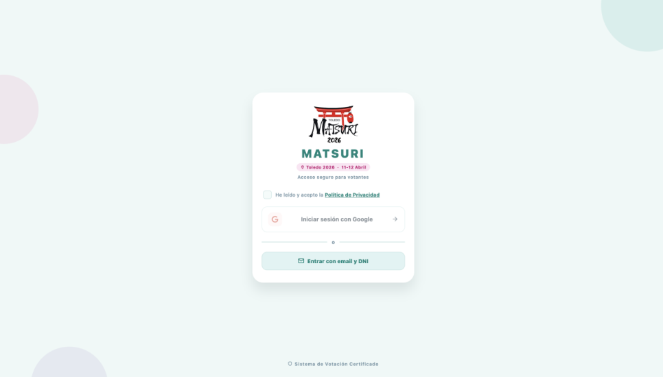
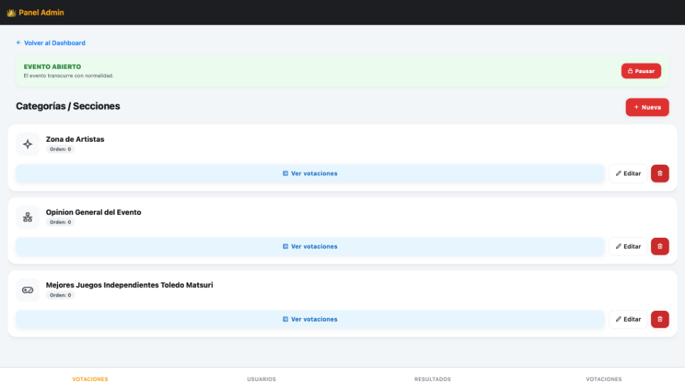
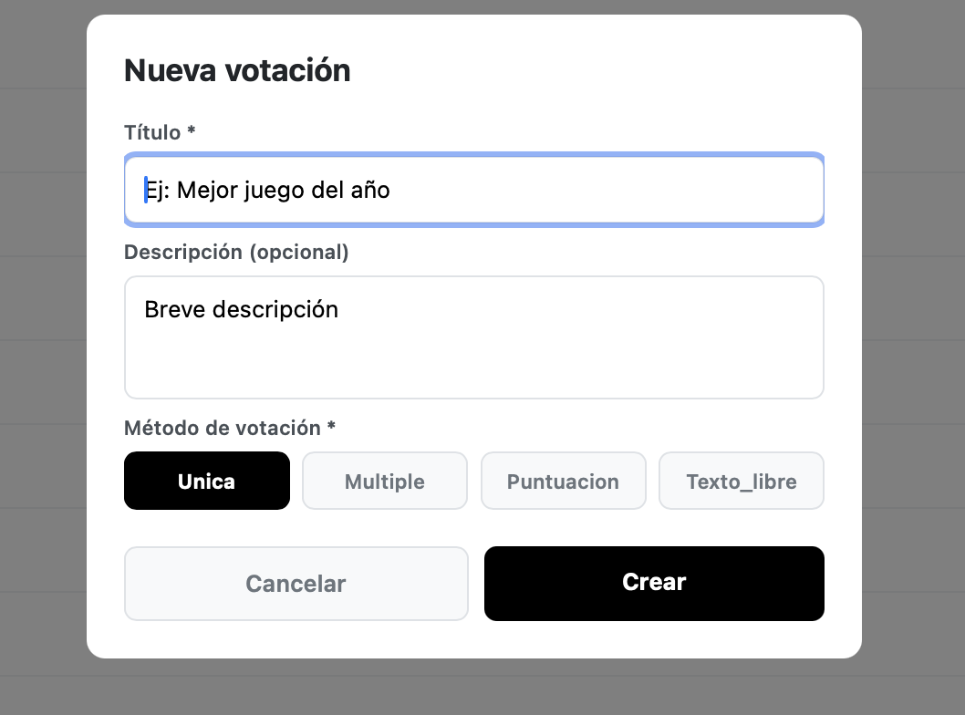

# 🗳️ Matsuri — Plataforma de Votaciones


Aplicación desarrollada durante mi periodo de prácticas en **Briefing Jane** para gestionar las votaciones de **Matsuri**. Reúne categorías, diferentes métodos de voto, identificación de participantes, resultados en tiempo real y administración del evento.

**[🚀 Abrir aplicación web](https://votaciones-matsuri.web.app/)** · **[📄 Ver documentación](docs/votaciones-matsuri.pdf)** · **[⬇️ Obtener PDF](https://github.com/josealonsogt/matsuri-votaciones-app/raw/refs/heads/main/docs/votaciones-matsuri.pdf)**

El acceso depende de la apertura del evento y de la configuración de Firebase. El panel administrativo requiere una cuenta autorizada; sus pantallas también pueden consultarse en el manual público.

## 📸 Capturas

### Acceso de usuarios



### Gestión del evento



### Métodos de votación



## ✨ Funcionalidades

### 👤 Participantes

- Acceso web mediante Google o correo electrónico y DNI.
- Validación del DNI y vinculación con una cuenta de Firebase Authentication.
- Registro del perfil y del índice de DNI mediante una transacción de Firestore.
- Navegación por categorías y votaciones.
- Registro de participación para evitar repetir el voto en una misma votación.
- Consulta de resultados después de participar.

### 🗳️ Métodos de voto

| Método | Funcionamiento |
| --- | --- |
| Selección única | Elegir una opción |
| Selección múltiple | Elegir varias opciones con un máximo configurable |
| Puntuación | Puntuar las opciones en una escala numérica |
| Texto libre | Introducir una respuesta escrita |

### 👑 Administración

- Crear, editar y eliminar categorías y votaciones.
- Gestionar las opciones de cada votación.
- Abrir, cerrar u ocultar votaciones.
- Generar códigos QR para acceder a una votación.
- Consultar usuarios y resultados globales.
- Abrir o cerrar el acceso general al evento.

## 🔐 Cómo funciona el acceso administrativo

Las cuentas autorizadas pueden ser cuentas de Google/Gmail. **Añadir las variables de entorno no concede permisos de administrador**: esas variables conectan la app con Firebase.

En el código actual:

1. `services/authService.ts` contiene la lista `ADMIN_EMAILS`, utilizada para asignar el rol al registrar un perfil nuevo.
2. El perfil se guarda en `usuarios/{uid}` de Cloud Firestore, con el campo `rol`.
3. `contexts/AuthContext.tsx` lee ese perfil y habilita el panel cuando `rol` vale `admin`.

Para una instancia propia, configura tus cuentas autorizadas y sus perfiles en tu proyecto Firebase. Cambiar la lista no actualiza automáticamente los perfiles ya registrados. No se publican credenciales de las cuentas utilizadas durante el evento.

La lista del cliente sirve para la asignación inicial y la interfaz; los permisos efectivos deben protegerse con reglas de Firestore que impidan a un usuario concederse el rol administrativo.

## 🛠️ Tecnologías

- React Native, Expo SDK 54 y React 19.
- Expo Router para las pantallas y rutas.
- TypeScript para los modelos y servicios.
- Firebase Authentication y Cloud Firestore.
- Estilos con `StyleSheet`, tema compartido y CSS global.
- Firebase Hosting para la versión web enlazada; el repositorio también incluye configuración de Vercel.

El proyecto utiliza React Native para sus vistas. El acceso Google actual utiliza `signInWithPopup`, por lo que ese flujo está orientado a navegador y necesita adaptación para una aplicación nativa.

## ⚙️ Instalación y configuración

Utiliza una versión de Node.js compatible con Expo SDK 54.

```bash
git clone https://github.com/josealonsogt/matsuri-votaciones-app.git
cd matsuri-votaciones-app
npm install
cp .env.example .env
```

Completa `.env` con la configuración de la aplicación web de **tu propio proyecto Firebase**:

```env
EXPO_PUBLIC_FIREBASE_API_KEY="your_api_key"
EXPO_PUBLIC_FIREBASE_AUTH_DOMAIN="your_project.firebaseapp.com"
EXPO_PUBLIC_FIREBASE_PROJECT_ID="your_project_id"
EXPO_PUBLIC_FIREBASE_STORAGE_BUCKET="your_storage_bucket"
EXPO_PUBLIC_FIREBASE_MESSAGING_SENDER_ID="your_sender_id"
EXPO_PUBLIC_FIREBASE_APP_ID="your_app_id"
```

Los nombres deben coincidir con los que lee `services/firebaseConfig.ts`. Copia el bucket exacto de tu configuración de Firebase.

Antes de ejecutar la aplicación:

1. Crea un proyecto Firebase y registra una aplicación web.
2. Habilita Google y correo/contraseña en Firebase Authentication, que son los proveedores que utiliza el código.
3. Añade los dominios desde los que accederás a la lista de dominios autorizados de Authentication.
4. Crea Cloud Firestore y configura sus reglas de acceso.
5. Configura los perfiles administrativos descritos arriba.

```bash
npm run web
```

También puedes iniciar Expo con `npm start`. Para generar la versión web:

```bash
npx expo export --platform web
```

`.env` y los archivos de configuración local quedan excluidos mediante `.gitignore`; `.env.example` sí se incluye. Las variables `EXPO_PUBLIC_*` se incorporan al cliente y no son un almacén de secretos. No introduzcas claves privadas ni cuentas de servicio.

Las reglas de Firestore se configuran en la instancia de Firebase; este repositorio no incluye un archivo de reglas desplegable. Configurar las variables por sí solo no reproduce los permisos ni los datos del evento original.

## 📂 Arquitectura

| Ruta | Responsabilidad |
| --- | --- |
| `app/` | Pantallas y rutas con Expo Router |
| `app/admin/` | Categorías, votaciones, usuarios y resultados |
| `contexts/` | Sesión, perfil y avisos |
| `hooks/` | Acceso Google |
| `services/` | Firebase, registro, votos y administración |
| `types/index.ts` | Modelos de usuarios, categorías, opciones y votos |
| `styles/` | Tema y estilos compartidos |
| `utils/` | Validación de DNI y utilidades |
| `docs/` | Manual público y capturas |

La lógica de votos está en `services/votacionesService.ts`; los tipos centrales se encuentran en `types/index.ts`.

## 📄 Documentación y contexto

El [manual público](docs/votaciones-matsuri.pdf) muestra el recorrido del usuario y las funciones del administrador. Los datos personales se han eliminado de las capturas. El enlace directo al PDF puede abrirlo en el navegador o descargarlo, según su configuración.

El proyecto resuelve la gestión de votaciones de un evento real, integrando participación, resultados y administración en una única aplicación.

Desarrollado por **[josealonsogt](https://github.com/josealonsogt)** durante su periodo de prácticas.
